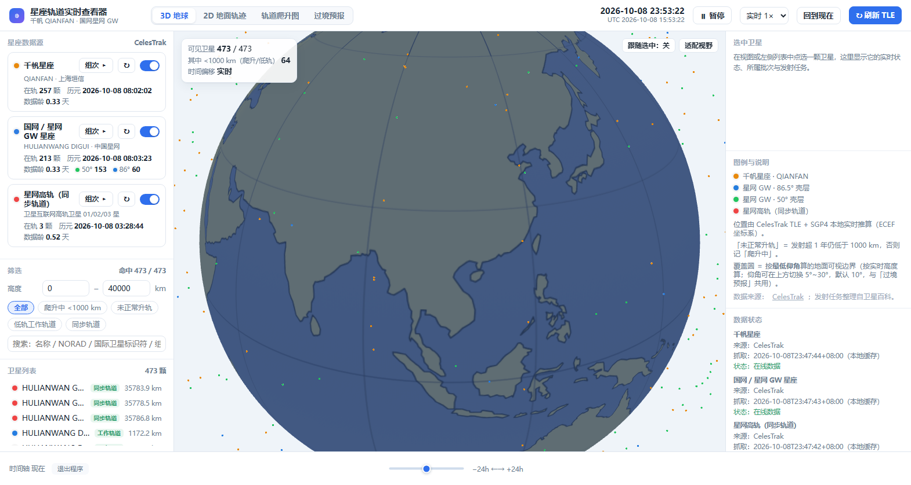
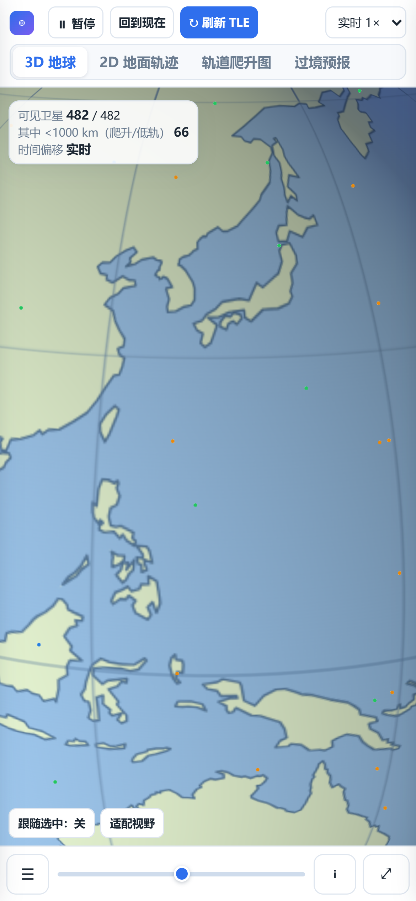
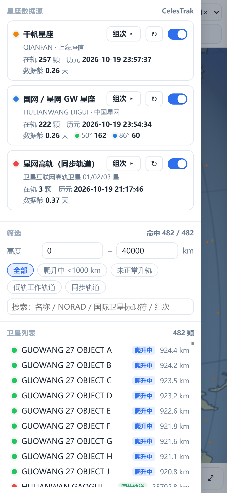
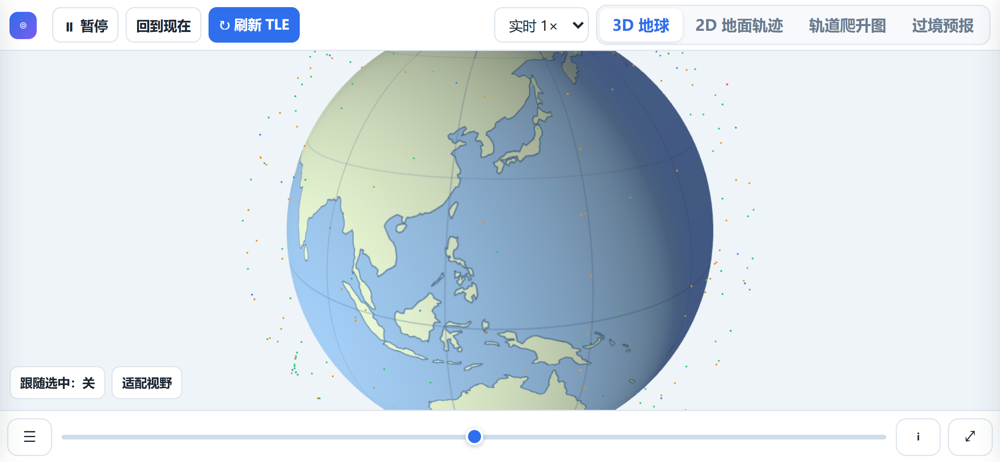
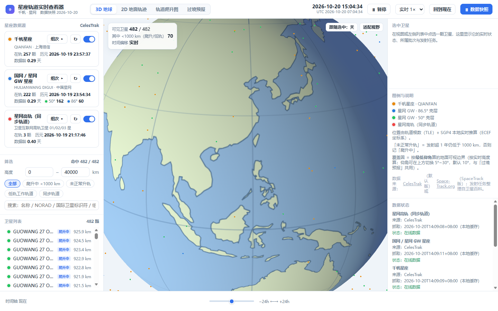

# 星座轨道实时查看器 · Constellation Orbit Viewer

> 千帆星座（QIANFAN）与国网 / 星网（HULIANWANG DIGUI）的**实时轨道查看器**：
> 3D 地球 / 2D 地面轨迹 / 轨道爬升大图 / 过境预报 四个视图，
> 数据取自 CelesTrak 公开根数，位置由 SGP4 在**本地**推算 —— 不上传任何东西，也不需要装依赖。
>
> A local, dependency-free viewer for China's LEO megaconstellations.
> Four views (3D globe / 2D ground track / orbit-raising charts / pass prediction),
> live TLE from CelesTrak, SGP4 propagation on your own machine. Works on desktop **and** phone.

<p align="center">
  
</p>
<p align="center">
  
  
  
</p>

当前快照：**482 颗**在轨目标 —— 千帆 **257**、星网低轨 **222**（50° 壳层 162 / 86.5° 壳层 60）、
星网高轨 **3**；根数历元 **2026-10-21**。仓库里带了这份数据，**克隆下来直接就能看**。

---

## 一、快速开始

### 方式 A：Windows 免安装 exe（推荐）

| 文件 | 说明 |
| --- | --- |
| `星座轨道实时查看器_桌面版.exe` | 双击弹独立窗口（WebView2，Win10/11 自带）。关窗口即退出。约 14 MB |
| `星座轨道实时查看器.exe` | 双击起本地服务并自动打开浏览器，**别关那个黑窗口**。约 9.9 MB |

两个都在 `dist\` 里有同名校验副本。首次启动会抓一次根数（约 10 秒），之后用磁盘缓存秒开。

### 方式 B：源码运行（Python 3.9+，零第三方依赖）

```bash
python server.py            # 默认 http://127.0.0.1:8770/
```

Windows 上也可以直接双击 `start.bat`（会自己找 Python 并打开浏览器）。

常用参数：

| 参数 | 说明 |
| --- | --- |
| `--port 8770` | 端口（被占用会自动往后找） |
| `--lan` | 允许手机 / 平板在同一 Wi-Fi 下访问（绑 `0.0.0.0`） |
| `--no-lan` | 强制只监听本机 |
| `--no-browser` | 不自动开浏览器 |
| `--proxy http://127.0.0.1:7890` | 手动指定代理（正常会自动探测） |

### 方式 C：手机 / 平板

桌面版、浏览器版、`start.bat` **默认都开了局域网访问**。启动后地址有两个地方能看到：

1. 命令行窗口里会印 `手机 / 平板访问（与本机连同一个 Wi-Fi）：http://192.168.x.x:8770/`；
2. 电脑页面上，右栏最底「数据状态」→ **手机访问**，点「复制」。

手机浏览器打开那个地址即可。窄屏下自动切换成：

- 顶栏两行：控制键 + 可横滑的视图切换；
- 左右两栏变**抽屉**：底栏 **☰** 开「星座 / 筛选 / 卫星列表」，**ℹ** 开「选中卫星 / 图例 / 数据状态」；
- **双指捏合**缩放地球，单指拖动转地球；
- 底栏 **⤢** 全屏（iPhone Safari 不支持网页全屏，该按钮自动隐藏）；
- 「退出程序」在手机上故意隐藏 —— 那一按关的是电脑那端的服务。

> 前提：手机与电脑在**同一个局域网**，且电脑那端的程序开着。校园网 / 公司网常开「客户端隔离」，
> 手机连着 Wi-Fi 也打不开；最稳的办法是手机开热点让电脑连。

---

## 二、在线版：给别人一个网址就能看

把仓库发布到 GitHub Pages 之后，任何人（不需要装 Python、不需要你的电脑开着）打开
`https://<用户名>.github.io/<仓库名>/` 就能看到完整的 3D 地球 / 2D 轨迹 / 爬升大图 / 过境预报。

**代价只有一个**：数据是**快照**，不能点按钮即时刷新（按钮会变成「⏸ 数据快照」）；位置仍按快照那批
根数实时推算、地球照样转。不过仓库里的 `.github/workflows/update-data.yml` 会让 **GitHub Actions
每 12 小时（UTC 00/12 = 北京 08:00 / 20:00）自动重烘一次 `docs/` 并提交**，所以线上数据不会一直
停在发布那天。

<p align="center">
  
</p>

### 怎么生成与发布

```bash
python build_pages.py      # 生成 docs/（约 5.5 MB，16 个文件）
```

然后 **不用命令行**，在 GitHub 网页上点：

> Settings → Pages → Source: **Deploy from a branch** → Branch: **main** / Folder: **/docs** → Save

等 1~2 分钟即可。

`build_pages.py` 做了四件事（细节见脚本头部注释）：

1. **烘快照** —— 起一个临时服务实例，把 `/api/groups`、`/api/tle?group=…`、逐日历史全落成 JSON；
2. **改路径** —— 页面里写的是绝对路径 `/web/…`，放在 `user.github.io/仓库名/` 这种子路径下
   会解析到域名根 → 404（这是 Pages 部署最常见的翻车），统一改成相对路径；
3. **装适配层** `pages_shim.js` —— 接管 `fetch`，把 `/api/*` 映射到上面的 JSON；
   大图里的「组次 / 单星」两个 iframe 子页共用同一份 `api/hist.json` 现场切片；
4. **比对** —— 把 shim 里复写的「组次筛选」逻辑与 `server.py` 的真接口**逐组比一遍**，
   不一致直接构建失败（两份实现最怕悄悄漂移）。

验收脚本：`node _chk_pages.mjs http://127.0.0.1:8891/orbit-viewer/`（20 项：零 4xx、
数据 482 颗、刷新按钮降级且数据不变、爬升大图与两个子页、手机单列布局）。
**注意要在子路径下测**（比如把 `docs/` 拷成 `_pages_test/orbit-viewer/` 再起静态服务），
放根目录测会漏掉绝对路径的坑。

---

## 三、四个视图

| 视图 | 看什么 |
| --- | --- |
| **3D 地球** | 482 颗星按壳层分色实时位置；可拖拽旋转、捏合缩放；选中后显示整圈轨道 + 覆盖圆 |
| **2D 地面轨迹** | 等经纬度世界地图 + 星下点 + 晨昏线夜半球；选中后画星下点轨迹 |
| **轨道爬升图** | 每颗星从发射到工作轨道的逐日高度曲线（千帆 / 星网各一张交互大图，可点行看组次） |
| **过境预报** | 填入观测点经纬度，算出「此刻头顶」与「未来 N 小时过境」列表 |

几个口径，避免误读：

- **覆盖圆**是按「最低仰角」算的**几何可视边界**，不是通信覆盖 —— 真正的可通信范围还要看星上波束、指向、链路预算，远比这个圈小。
- **过境预报**算的是**几何过境**，不考虑日照、不预报星等。想找真正肉眼可见的过境请查 Heavens-Above。
- 「未正常升轨」＝ 发射超 1 年仍低于 1000 km，否则记「爬升中」。

---

## 四、数据来源与致谢

| 用途 | 来源 |
| --- | --- |
| 轨道根数（TLE / OMM）、逐日高度 | [CelesTrak](https://celestrak.org)（GP / OMM / `graph-orbit-data`） |
| 发射任务、批次、研制方 | [卫星百科](https://sat.huijiwiki.com)（整理为本地静态表） |
| 地球海岸线 | [Natural Earth](https://www.naturalearthdata.com/)（公有领域） |
| SGP4 传播 | [satellite.js](https://github.com/shashwatak/satellite-js) v5.0.0（MIT，`web/satellite.min.js`） |

本项目与 CelesTrak、卫星百科均无隶属关系；**请遵守上游站点的使用条款与速率限制**。

`data/sat_hist.json` 是**抓取快照**（482 颗真实 TLE 的逐日高度历史），随仓库发布以保证「开箱即用」，
不代表实时数据。运行中程序会自己补齐与更新它。

另有一个 `_SpaceTrack版` 变体，数据源换成 [Space-Track.org](https://www.space-track.org)，
需要自备 `spacetrack.txt`（两行 `identity=` / `password=`）。**该文件已被 `.gitignore` 排除，不要提交。**

---

## 五、目录结构（核心部分）

```
server.py                 本地 HTTP 服务 + TLE 抓取 + 缓存（纯标准库）
desktop.py                桌面版入口（pywebview / WebView2）
web/
  index.html              单页前端（3D WebGL + 2D Canvas + 过境预报）
  mobile.css / mobile.js  ★ 窄屏与触屏适配（共享，两个页面各引一行）
  satellite.min.js        satellite.js v5.0.0（MIT）
  world.js                Natural Earth 海岸线（公有领域）
  raise/                  两张轨道爬升交互大图（生成的，随仓库发布）
web_nopass/               「不含过境预报」变体前端（由 _make_nopass.py 生成，不入库）
data/
  sat_hist.json           逐日高度历史快照
  qianfan_analysis.json   千帆逐星元信息（倾角 / 就位日期 / 状态口径）
  launches*.json          发射任务表
make_qf_html.py           重生成千帆爬升大图
make_gw_html.py           重生成星网爬升大图
refresh_deliverables.py   一键更新：追平历史 → 两张图 → 同步覆盖层 → 截图
local_backfill.py         用批量根数把逐日历史末点追平到今天
```

### 程序会自己更新什么

- 根数（TLE）缓存 2 小时；前端每 6 小时整刷一次，也可以点「↻ 刷新 TLE」强制重取；
- 逐日高度历史每 3 小时补当天点；
- 两张爬升大图启动 60 秒后检查、每 12 小时重生成一轮（`refresh_deliverables.py`）；
- **exe 本身不会自动更新** —— 换版本要重新拿文件。

> exe 把 `web/` 打进包，**打包那一刻就冻结**。所以 `web_live\raise\` 做了一层磁盘覆盖层：
> 大图改了不用重打包，`/web/raise/…` 会优先读 exe 同目录下的 `web_live\raise\`。

---

## 六、自检

仓库里保留了开发时用的自检脚本（都是「关系断言」，不写死颗数，数据自然会变也不会假红）：

```bash
# 交互基线 36 项（选中 / 视图切换 / 轨迹开关 / 过境面板 …）
node _selfcheck.mjs http://127.0.0.1:8770/ 9370

# 移动端 35 项（390×844 / 820×1180 / 1440×900 三档视口、抽屉、双指捏合、/api/net）
node _chk_mobile.mjs http://127.0.0.1:8770/ 9371

# 打包内容比对 52 项（内嵌页面 / mobile.css / mobile.js / 历史库 / 数据源归属 / 覆盖层）
python _verify_exe_payload.py

# 安全专项 22 项（CSRF / DNS 重绑定 / 目录穿越 / force=1 跨站）
python _audit_security.py

# 多视口布局截图（Layout 验收，输出到 _shots/）
node _shot_mobile.mjs http://127.0.0.1:8770/ _shots 9351

# 静态站 20 项（零 4xx / 482 颗 / 刷新降级后数据不变 / 大图与两个子页 / 手机单列）
python build_pages.py
node _chk_pages.mjs http://127.0.0.1:8891/orbit-viewer/ 9380
```

---

## 七、已知限制

- 位置由公开根数推算，误差随历元变旧而增大；数据龄超 2 周建议先刷新。
- **手机竖屏看 2D 视图是一条横向长条**：2D 是 2:1 的等经纬度世界地图，竖屏只能按宽度铺满，上下留白多。
  想看细节请横屏或切 3D（这一版没做 2D 拖动平移）。
- 地球底图是浅色示意风格，不是真实影像。
- 爬升大图的曲线按 `MAXPTS` 降采样，图内点数可能少于库内点数（同源，不是数据漂移）。
- 人工维护的发射表永远比现实慢半拍；界面缺最新一发时，先看 `data/*launches*.json` 最后一条再去数据源补录。

---

## 八、许可证

[MIT](LICENSE) © 2026 张庭瑜 (Tingyu Zhang)

第三方组件各自遵循其原始许可证：satellite.js（MIT）、Natural Earth（公有领域）。
